# NHTSA Recall Lag Analysis: Results

## The question
After owners start complaining to NHTSA about a vehicle component, how long until that vehicle is recalled for it? Do some manufacturers or components consistently lag, and what predicts a slow recall?

This measures **time-to-action** (complaint filed → recall announced), not negligence or fault.

## Approach in brief

A complaint is matched to a recall only when **the same model and model year** was recalled for **the same component** by the same manufacturer, and the complaint was filed before the recall. Matching on manufacturer + component alone would pair a Ford F-150 engine complaint with every Ford engine recall, most of them for unrelated vehicles. Lag is then measured **once per recall campaign**, so busy components aren't counted many times over. Design decisions in full: [../README.md](../README.md).

| | |
|---|---|
| Join key | manufacturer + component + model + model year |
| Complaint → recall pairs | **397,145** (all manufacturers, all components) |
| Recalls per matched complaint | **1.7** on average |
| Join run time | **about 25 seconds** in SQL Server |
| Unit of analysis for lag | recall campaign |
| Complaints | **1.55M**, each counted once (raw file has 2.11M component lines) |
| Deaths reported in complaints | **4,534** |

## Data
- **Complaints:** NHTSA `FLAT_CMPL`, vehicle complaints from 1995 to Aug 2026, 1,550,612 complaints after cleaning
- **Recalls:** NHTSA `FLAT_RCL` (pre- and post-2010 files), 11,059 vehicle recall campaigns from passenger-vehicle manufacturers
- **Lag analysis window:** recalls from 2005 onward (complaints begin in 1995, and the lookback is 10 years), 6,418 campaigns

---

## Key findings

### 1. Half of all recalls had no owner complaint beforehand
Of 6,418 vehicle recall campaigns since 2005, **50.6%** had at least one earlier complaint about the same model, year and component, and only **25.3%** had ten or more. The other half came from manufacturers' own testing, warranty data or field reports. Complaint data can only ever explain part of the recall pipeline.

### 2. The typical recall comes about two years after the first complaint
For the 3,246 campaigns that did have earlier complaints:

| Measure | Median | 95% CI |
|---|---|---|
| First matching complaint → recall | **766 days (2.1 years)** | 711–831 |
| Third matching complaint → recall ("signal" lag, 2,368 campaigns) | **898 days** | 835–950 |

The spread is wide: a quarter of recalls come within 260 days, while 26% take more than 5 years. 192 campaigns sit right at the 10-year lookback limit; those are long-running models where the "first complaint" may be an old, unrelated one. That is why the 3rd-complaint signal lag is reported alongside.

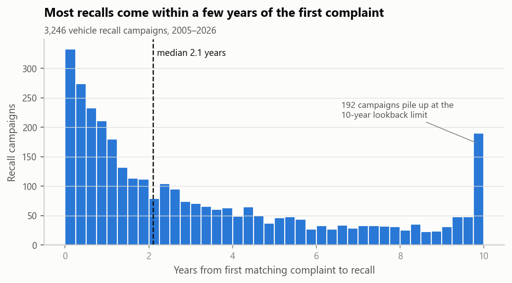

**The window matters.** Using the same campaigns, the median is 302 days with a 1-year lookback, 526 days with 2 years, 730 with 5 and 766 with 10. A short lookback (e.g. 12 months) would report less than half the real lag, which is why a 10-year window is used.

### 3. Manufacturers differ, but less than you might expect
| Manufacturer | Campaigns | Median lag (days) | 95% CI |
|---|---|---|---|
| Chrysler (incl. Dodge/Jeep/Ram) | 456 | **629** | 515–720 |
| Hyundai | 163 | 714 | 472–1,058 |
| Nissan | 159 | 721 | 535–966 |
| Toyota | 206 | 776 | 606–992 |
| General Motors | 348 | 820 | 632–1,063 |
| Kia | 121 | 846 | 593–1,265 |
| Volkswagen | 199 | 847 | 621–1,108 |
| BMW | 167 | 854 | 568–1,239 |
| Honda | 190 | 888 | 809–1,178 |
| Ford | 537 | **892** | 773–1,025 |

The difference across manufacturers is statistically real (Kruskal-Wallis p = 0.023), but most confidence intervals overlap. Honda sits among the slowest, partly because of its long Takata air bag history (see Finding 5).

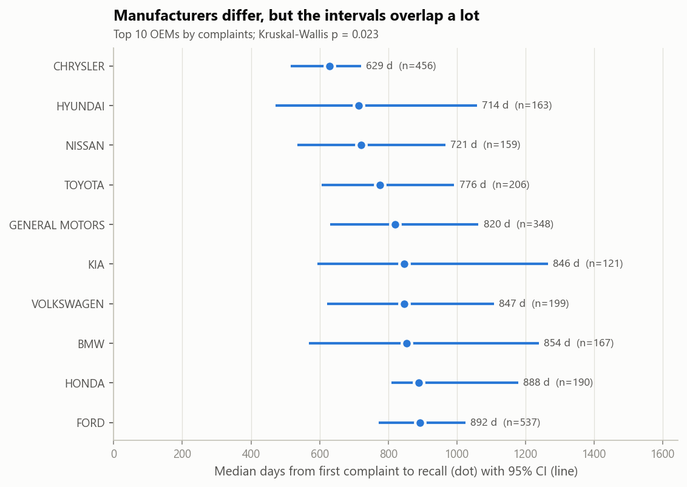

### 4. The component matters about 6× more than the manufacturer
Component explains **5.1%** of the variation in (log) lag; manufacturer explains **0.9%** (p < 0.001 for components). Both are small: most of the variation is campaign-specific.

| Component | Campaigns | Median lag (days) | 95% CI |
|---|---|---|---|
| Steering | 169 | **518** | 407–759 |
| Power train | 295 | 568 | 460–703 |
| Electrical system | 579 | 650 | 538–775 |
| Engine | 227 | 794 | 607–1,012 |
| Service brakes, hydraulic | 112 | 882 | 646–1,232 |
| Structure | 131 | 885 | 638–1,263 |
| Suspension | 103 | 1,362 | 729–1,797 |
| Air bags | 549 | **1,710** | 1,437–2,020 |
| Vehicle speed control | 31 | **1,752** | 929–2,466 |

Steering and power train defects are recalled fastest; air bags and vehicle speed control slowest. Vehicle speed control rests on only 31 campaigns, so its interval is wide. Non-hydraulic service brakes (14 campaigns, median 478 days, CI 153–919) are left out of the table because the sample is too small to rank.

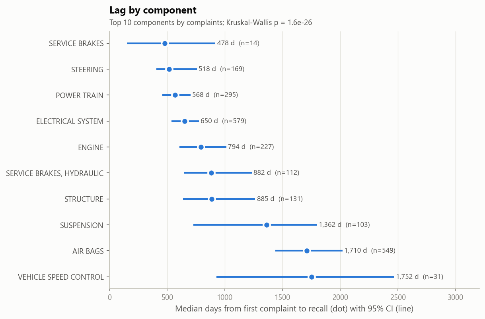

### 5. Air bags are the slow cell for almost every manufacturer
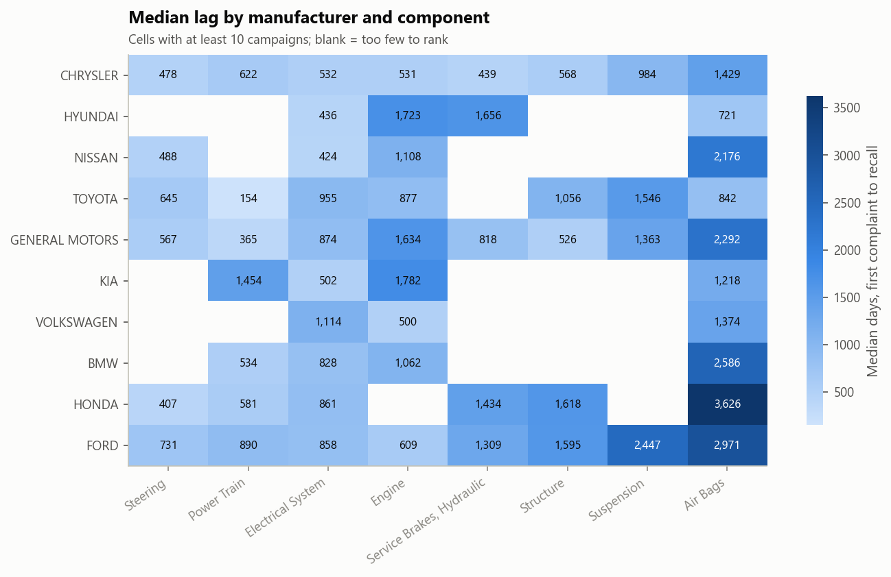

Honda air bags (3,626 days), Ford air bags (2,971) and BMW air bags (2,587) are the slowest combinations with at least 10 campaigns. Hyundai (721) and Toyota (842) are the exceptions. This is mostly the Takata inflator saga, where recalls kept expanding to older model years for a decade.

### 6. Severity: air bags cause the most deaths in total, but tires and seat belts are the deadliest per complaint
Each complaint is counted once per component (the raw file repeats a complaint on one row per component line, which would inflate totals). Complaints report **4,534** deaths and **83,878** injuries in total.

| Component | Complaints | Deaths | Deaths per 1,000 complaints | % crash |
|---|---|---|---|---|
| Tires | 35,396 | 490 | **13.8** | 6.2 |
| Seat belts | 37,501 | 446 | **11.9** | 13.9 |
| Vehicle speed control | 82,693 | 667 | 8.1 | 17.0 |
| Air bags | 152,799 | **1,057** | 6.9 | **25.6** |
| Forward collision avoidance | 21,440 | 124 | 5.8 | 9.9 |
| Engine | 274,449 | 351 | 1.3 | 1.6 |

- **Air bags** have the most deaths in total and the highest crash rate.
- Per complaint, **tires and seat belts** are the deadliest components. Ranking by raw totals would hide this, because totals mostly track complaint volume.
- **Engine** has many complaints but only 1.3 deaths per 1,000, near the bottom.
- **Electrical system** has the highest fire rate (7.3% of complaints), then seats (5.4%) and engine (4.8%).

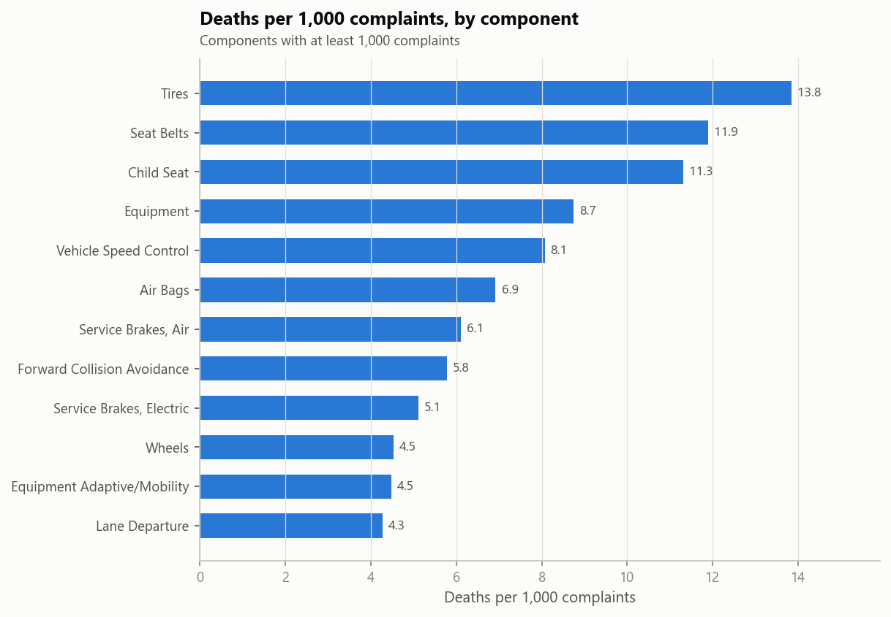

### 7. Severe complaints are not followed by recalls more often or sooner
Per complaint (filed 2000 onward, each with at least 2 years of follow-up):

| Complaint type | Complaints | Recalled within 2 years |
|---|---|---|
| Fatal | 2,707 | 6.3% |
| Injury | 61,653 | 7.7% |
| Crash, no injury | 52,398 | 7.0% |
| Fire, no crash | 34,261 | 8.6% |
| No crash, fire or injury | 1,429,613 | 8.3% |

Fatal and crash complaints are slightly **less** likely to be followed by a recall (chi-square p < 0.001). Among complaints that were recalled, crash complaints waited a median 586 days vs 510 (Mann-Whitney p < 0.001, but the effect size is small: rank-biserial −0.08). A possible explanation, **not tested here**: many severe complaints are one-off incidents (impaired driving, other vehicles), while recalls follow repeated, mechanical failure patterns.

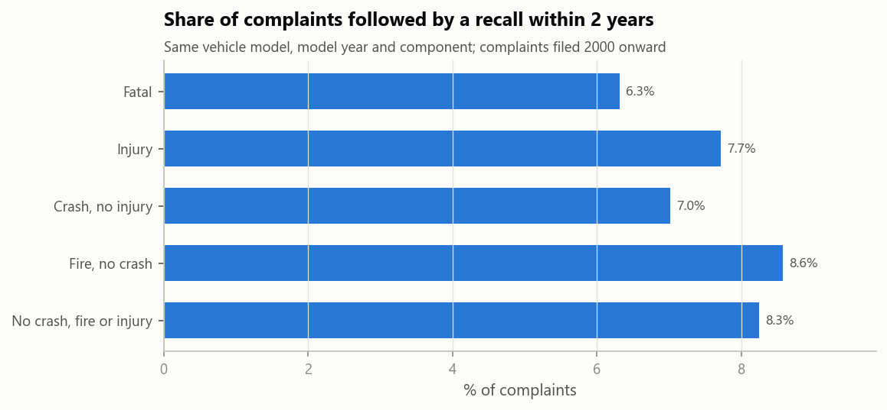

### 8. Recall lag hasn't improved in 20 years, but recall volume has doubled
Median lag by recall year shows no trend (Spearman ρ = −0.03, p = 0.90): 600 days in 2005, 823 in 2025. Recall campaigns per year roughly doubled, from 150–200 in 2005–2013 to 400–460 in 2021–2025. Lag is grouped by recall year, so every year's campaigns are complete and recent years don't need to be cut off.

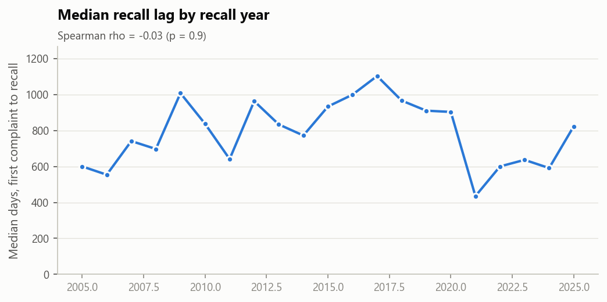

### 9. Only 12% of complaints are followed by a recall of that vehicle within 5 years
A complaint counts as recalled only if the same model, model year and component was recalled afterwards. Only complaints filed at least 5 years before the data ends are included, so recent complaints don't look "never recalled" just because there hasn't been time.

| Recalled within | 1 year | 2 years | 5 years |
|---|---|---|---|
| Share of complaints | 5.4% | 8.0% | **12.3%** |

By component: air bags 44.7% (Takata again), steering 14.5%, electrical 13.7%, down to service brakes 4.8%. By manufacturer: BMW 19.2% highest, Nissan 6.9% lowest.

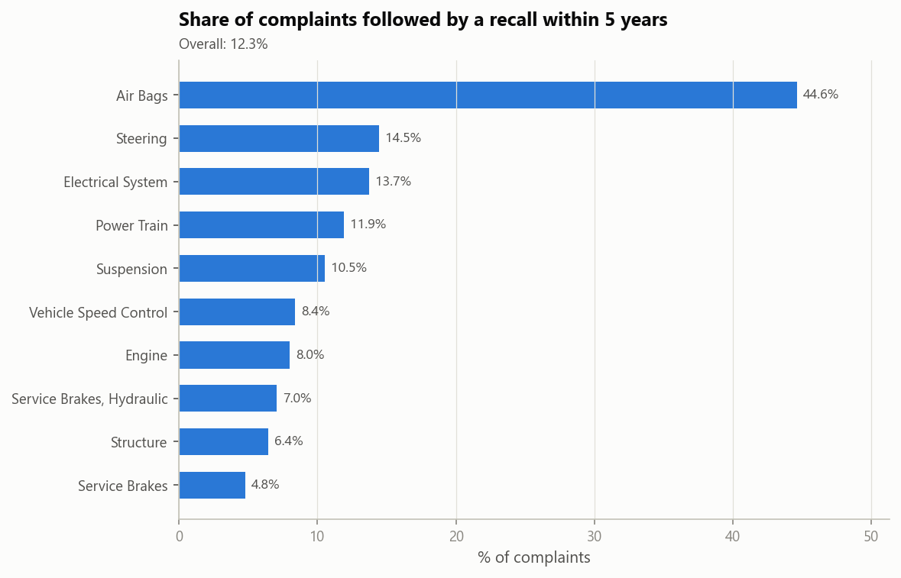

### 10. Monthly complaint spikes do not predict recalls
With a zero-filled monthly calendar and a baseline:
- Months with an organic complaint spike (≥2× the trailing 6-month average, no recent recall) were followed by a recall of that manufacturer + component within 6 months **24.3%** of the time, vs **27.0%** for normal months (lift 0.9×, Fisher p = 0.048).
- 15.1% of recall months had a spike in the prior 6 months, against a baseline of 15.3% for all months.

Without the baseline, "15% of recalls had a spike beforehand" would look like a signal; compared with ordinary months, it isn't. At manufacturer + component level, monthly volume is too coarse to be an early-warning signal; a model-level signal would be the next thing to test.

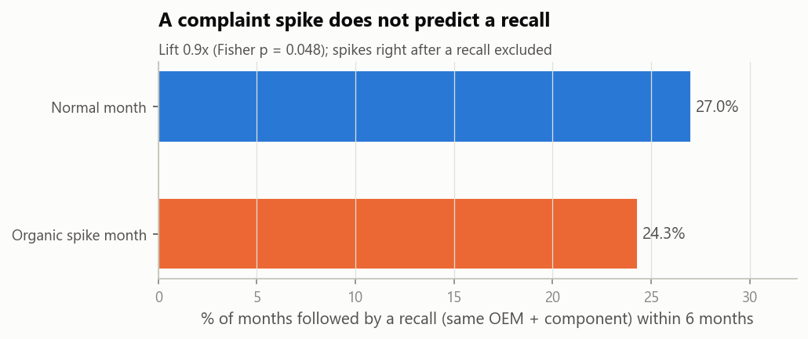

### 11. Air bags: inflator ruptures are a fifth of campaigns but half of the vehicles
1,012 vehicle air bag campaigns, one category each (first matching rule wins, word-boundary matching, sampled and read for validation):

| Failure mode | Campaigns | % of campaigns | % of vehicles affected |
|---|---|---|---|
| Inflator rupture / metal fragments | 226 | 22.3% | **48.6%** |
| Occupant classification / sensor | 162 | 16.0% | 10.8% |
| Wiring / connector / clockspring | 73 | 7.2% | 9.7% |
| Assembly / fastener | 56 | 5.5% | 1.0% |
| Will not deploy (other cause) | 54 | 5.3% | 1.3% |
| Inadvertent deployment | 49 | 4.8% | 7.2% |
| Software / calibration | 42 | 4.2% | 4.0% |
| Cushion tear / fold | 42 | 4.2% | 0.8% |
| Cover / trim / emblem | 29 | 2.9% | 1.1% |
| Warning lamp / label / manual | 14 | 1.4% | 1.0% |
| Uncategorized | 265 | 26.2% | 14.4% |

About a quarter of campaigns use defect wording too varied to classify with keyword rules; text classification on the full descriptions would be the next step. Vehicle counts are summed per campaign, so a vehicle recalled twice counts twice.

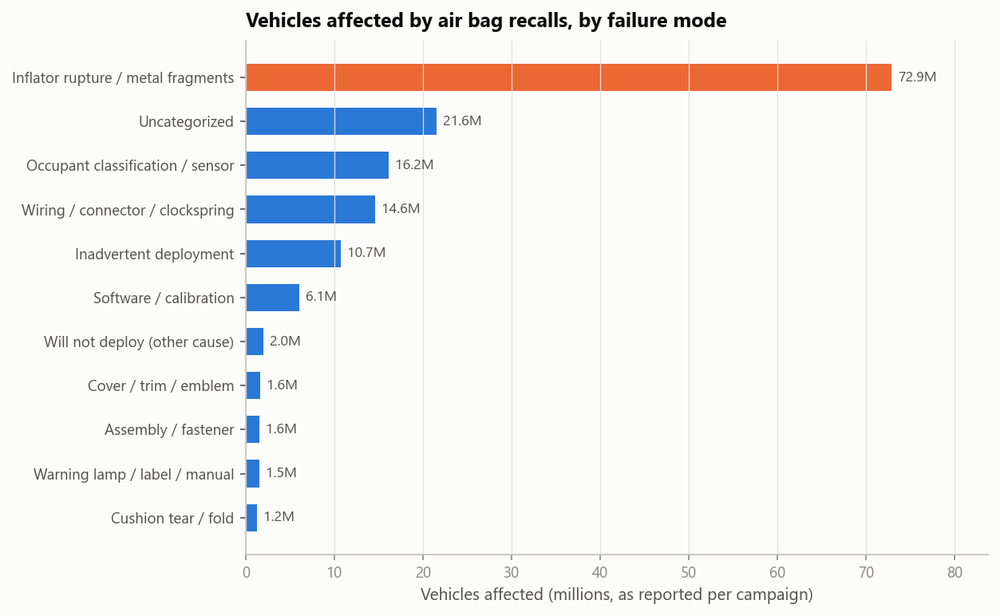

### 12. Recalls NHTSA had to push for came 3× later, after 8× more complaints
NHTSA records whether its Office of Defects Investigation influenced a recall (`INFLUENCED_BY`).

| | Manufacturer-initiated | NHTSA-influenced |
|---|---|---|
| Share of campaigns | 86.1% | 13.9% |
| Share of vehicles affected | 59.2% | **40.8%** |
| Preceded by ≥1 complaint | 45.3% | **83.4%** |
| Median lag, first complaint → recall | 568 days | **1,772 days** |
| Median complaints before recall | 6 | **51** |
| "Do not drive" advisory | 1.1% | 5.5% |

Both differences are highly significant (Mann-Whitney p < 0.001). This is an association: NHTSA tends to step in on cases that are already dragging, so it doesn't mean NHTSA involvement causes delay. Share of each manufacturer's recalls that were NHTSA-influenced: Hyundai 21.1%, Ford 20.7%, Honda 18.3% at the top; BMW 7.8%, Volkswagen 8.1%, Toyota 8.6% at the bottom.

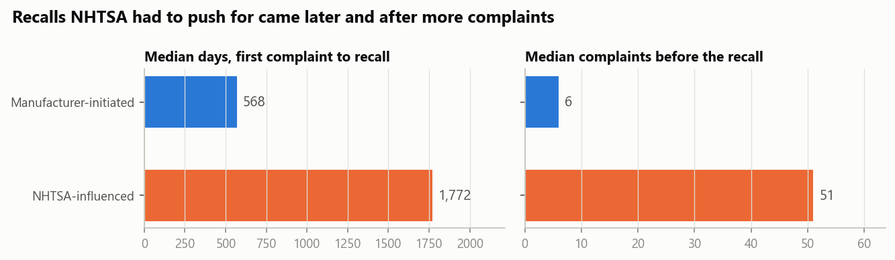

---

## Methodology notes and limitations
- **Matching depends on model names.** Names are normalised (uppercase, letters and digits only) and 98.7% of complaint make/model pairs appear in the recall data, but trims coded differently (e.g. `F-250 SD` vs `F-250`) won't match, so some real matches are missed.
- **First-complaint lag is sensitive to stray early complaints**, hence the 3rd-complaint signal lag and the 10-year cap pile-up noted in Finding 2.
- **Complaint and recall component coding can differ** for the same defect (e.g. an air bag warning light filed under electrical), which also causes missed matches.
- A complaint naming two components counts under both in per-component tables.
- **Scope:** passenger-vehicle manufacturers (identified by make), vehicle records only; heavy trucks, RVs, buses and motorcycles are excluded.
- Associations, not causes: none of these results show why a recall was slow.

## Reproduce
See [../README.md](../README.md). Every number above is in `key_numbers.json`, `tables/` or `sql_output/`.

## Tech stack
**Python** (pandas with Arrow strings, SciPy, matplotlib) · **SQL Server 2022** (window functions, `PERCENTILE_CONT`, recursive CTE calendar, views, clustered index design) · statistics: bootstrap CIs, Kruskal-Wallis, Mann-Whitney, chi-square, Fisher's exact
